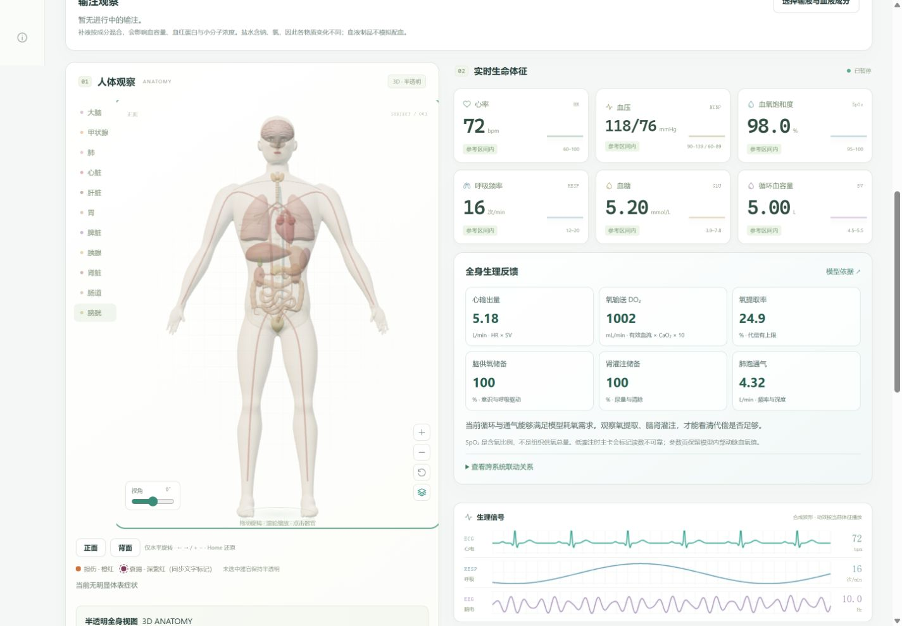

<div align="center">

# 🫀 VITALIS · Human Physiology Lab

**A 3D human-body game simulator · For entertainment and interactive exploration only**


[](LICENSE)

[简体中文](README.md) · **English**

[Features](#features) · [Quick start](#quick-start) · [Usage](#usage) · [Development](#development) · [Model limitations](#model-notes)

</div>

> [!IMPORTANT]
> **This project is a game simulator, not a research tool, medical application, or real-world prediction system.**
> All values, charts, symptoms, drug responses, screenshots, and exported results are game-generated outputs. **They must not be used for scientific research, publications or experimental evidence, clinical care, real medication decisions, emergency guidance, safety assessment, or any other real-world application or decision.** The game is for entertainment and interactive exploration only; its results cannot establish real human responses or safety.



<a id="features"></a>
## ✨ Features

| Module | Capabilities |
| --- | --- |
| **3D anatomy** | A male A-pose body, 11 organ groups, and a continuous brain with modeled folds; translucent by default, opaque when selected |
| **Monitoring** | 79 parameters across circulation, breathing, glucose, electrolytes, acid–base balance, liver and kidney function, consciousness, and coagulation; trends and synthetic waveforms |
| **Drug experiments** | 55 drugs in 16 pharmacological categories; combinations, dose sliders, administration routes, and concentration / volume controls for selected liquid formulations |
| **Food and infusions** | 22 foods and beverages, plus 5 fluid / blood-component products; digestion, absorption, volume, and dilution effects |
| **Symptoms and injury** | 54 symptom rules and 6 types of irreversible organ injury; cyanotic lips, jaundice, convulsions, and injury colors on the body |
| **Infection and rescue** | 6 synthetic infection scenarios; manual compression clicks, intubation, assisted ventilation, and oxygen support controlled separately |
| **Experiment tools** | 8 baseline profiles, 1×–300× speed, fast-forward, event logs, browser saves, JSON import / export, and CSV time-series export |

### Connected physiological systems

Deterministic equations connect circulation and oxygen delivery, ventilation and acid–base balance, brain and kidney perfusion, glucose metabolism, electrolytes, fluid mixing, and drug clearance. Symptoms respond to the simulated state; an intervention can affect more than a single isolated number.

- Separate progress bars show drug activity and estimated remaining effect time.
- Repeated administration can accumulate, and modeled interactions can alter responses.
- **Remove drug** is an experiment-editing action: it clears remaining batches and effects while preserving changes, infused fluid, and injury that have already occurred.
- Heart motion, breathing, and optional monitor sounds follow the current vital signs rather than the simulation-speed multiplier.

<a id="quick-start"></a>
## 🚀 Quick start

**Requirements:** Node.js 20+ and a modern browser with WebGL2 support.

```sh
git clone https://github.com/Barton-zhang666/Bodytest.git
cd Bodytest
npm run dev
```

Open **[http://127.0.0.1:4173](http://127.0.0.1:4173)**.

No initial `npm install` is required for normal use: Three.js and model assets are included in the repository. Install development dependencies only when modifying and regenerating the body shell. Open the app through HTTP rather than double-clicking `index.html`, because it uses ES modules.

<details>
<summary>Need a different port?</summary>

PowerShell:

```powershell
$env:PORT = '4174'
npm run dev
```

macOS / Linux:

```sh
PORT=4174 npm run dev
```

The development server listens on `127.0.0.1` only. Stop it with `Ctrl+C`.

</details>

<a id="usage"></a>
## 🧪 Usage

1. **Choose a baseline:** healthy, hypertension, hyperglycemia, low blood volume, or another synthetic profile.
2. **Add interventions:** search the drug, food, or infusion catalog, add items to the queue, and adjust their amounts. Infection scenarios are added independently.
3. **Run and observe:** start or fast-forward the simulation and inspect vital signs, symptoms, organ appearance, and active drugs.
4. **Review the experiment:** explore trends and event logs, then export a JSON save or CSV time series.

A serving of rice is a simple starting point for observing digestion and changes in simulated blood glucose.

| Anatomy control | Interaction |
| --- | --- |
| Horizontal rotation | Drag horizontally with a mouse or finger, or use `←` / `→`; rotation is limited to the body's vertical axis |
| Cursor-centered zoom | Use the mouse wheel; `+` / `−` and zoom buttons reuse the last pointer position |
| Organ selection | Click an organ or its list entry; click again or press `Esc` to deselect |
| Reset view | Press `Home` or use Reset; front and back shortcuts are also available |
| Audio | Explicitly enable sound, then adjust the volume, mute, or preview effects |

**The application UI is currently in Simplified Chinese.** This repository provides Chinese and English README files. Experiments are stored in the current browser and resume paused after a refresh. Background tabs do not accumulate offline simulation time.

<a id="development"></a>
## 🛠️ Development

Built with native HTML, CSS, and ES modules. The physiology engine has no DOM dependency. There is no frontend framework, runtime CDN, remotely loaded body asset, or server-side database.

```text
Bodytest/
├── index.html                  Application entry
├── src/
│   ├── main.js                 Interaction, state, persistence, and export
│   ├── data/                   Drugs, food, metrics, interactions, and body data
│   ├── engine/                 Deterministic physiology, kinetics, injury, and infection
│   ├── ui/                     3D anatomy, charts, symptom appearance, and audio
│   ├── assets/                 Local audio and license notices
│   └── vendor/three/           Pinned Three.js modules and license
├── scripts/                    Local server, build, syntax checks, and mesh generation
├── tests/                      Mechanism, replay, boundary, and geometry tests
├── README.md                   Chinese documentation
├── README.en.md                English documentation
└── LICENSE                     MIT
```

| Command | Purpose |
| --- | --- |
| `npm run dev` | Start the local server |
| `npm test` | Run automated tests |
| `npm run check` | Check JavaScript syntax |
| `npm run build` | Produce the static site in `dist/` |
| `npm run model:generate` | Regenerate the body shell offline; run `npm ci` first |

Add drugs, foods, and parameters to `src/data/` first. After changing a model mechanism, run tests, syntax checks, and a build. Preserve the fixed integration step and avoid random fabricated vital signs. Changes to equations or data semantics require an explicit model-version and save-migration strategy.

The current application version is **5.3.1**, with **V5** physiology and save formats. The 3D scene contains approximately 219,000 triangles, caps pixel density, and renders on demand while paused. The body shell is generated offline, brain grooves are constructed during initialization, and meshes are not rebuilt during animation.

<a id="model-notes"></a>
## Model limitations

**Game use only: no result may be used for research or any real-world application. This restriction also applies to exported, captured, or quoted results.**

- **Educational approximation:** the app does not predict individual responses or cover every interaction, disease mechanism, or population. An absence of symptoms does not imply safety.
- **Rescue scenarios:** support remains possible after cardiac or respiratory arrest. Simulation termination uses an irreversible brain-injury proxy threshold, not clinical brain-death criteria.
- **Infection scenarios:** pathogen load and susceptibility are synthetic parameters, not real injection doses or clinical susceptibility results.
- **Timing and signals:** effect duration depends on modeled clearance and effect compartments. ECG, EEG, and other waveforms are synthetic rather than diagnostic recordings.
- **Anatomy:** the body and organs are procedurally generated for visual recognition and observation, not derived from human scans or intended for measurement.

Automated tests only verify game-program behavior and internal numerical rules. **They do not establish scientific validity, clinical accuracy, or real-world applicability, and do not qualify the results for research or practical use.**

<a id="credits"></a>
## License and credits

The project is released under the **[MIT License](LICENSE)**. Third-party components retain their own licenses:

| Component / asset | Purpose | Source and license |
| --- | --- | --- |
| Three.js 0.186.1 | Local WebGL2 rendering | [Official package](https://registry.npmjs.org/three/-/three-0.186.1.tgz) · [MIT](src/vendor/three/LICENSE) |
| meshoptimizer 1.3.0 | Offline body-mesh simplification only | [Upstream project](https://github.com/zeux/meshoptimizer) · MIT; pinned version and integrity in the lockfile |
| Kenney Interface Sounds | Click and confirmation feedback | [Asset source](https://kenney.nl/assets/interface-sounds) · [CC0 notice](src/assets/audio/LICENSE-Kenney.txt) |

The two local Three.js modules preserve the official package contents. Body and organ meshes are generated by this project. Monitor tones use Web Audio synthesis. Some drug-timing references link to [DailyMed](https://dailymed.nlm.nih.gov/dailymed/), while simulation parameters remain educational approximations.

---

<div align="center">

[Report an issue](https://github.com/Barton-zhang666/Bodytest/issues) · [Source code](https://github.com/Barton-zhang666/Bodytest) · [切换为简体中文](README.md)

</div>
